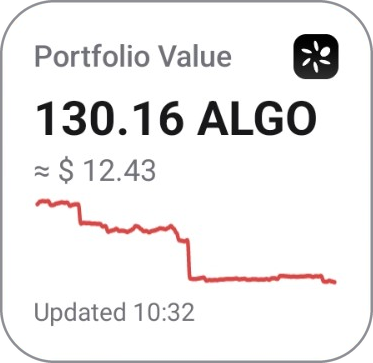
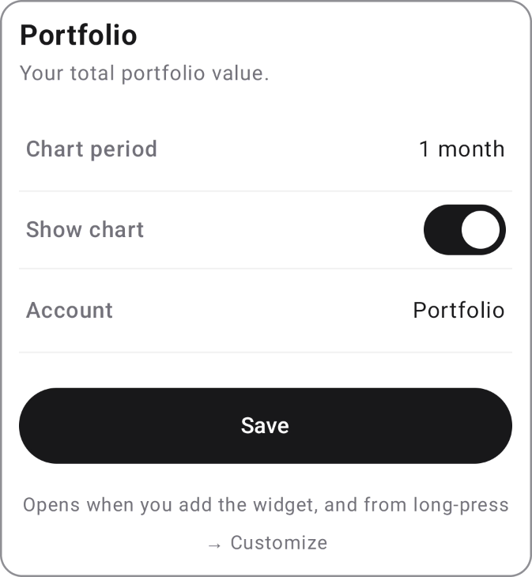
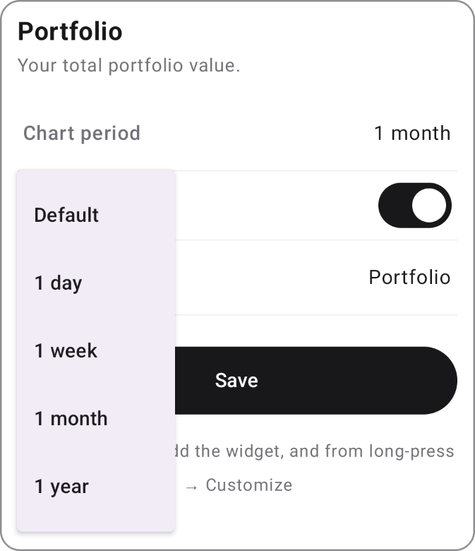
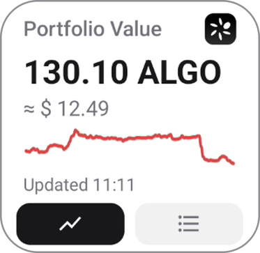
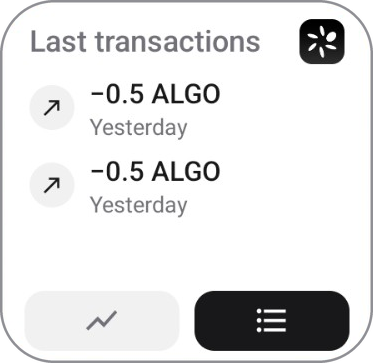
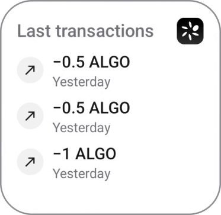
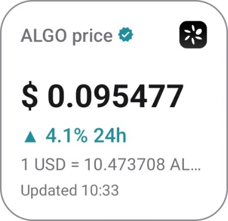
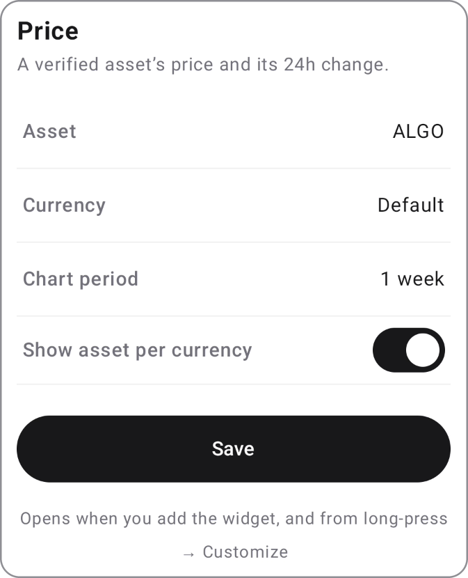
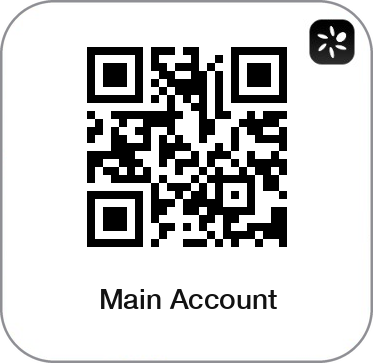
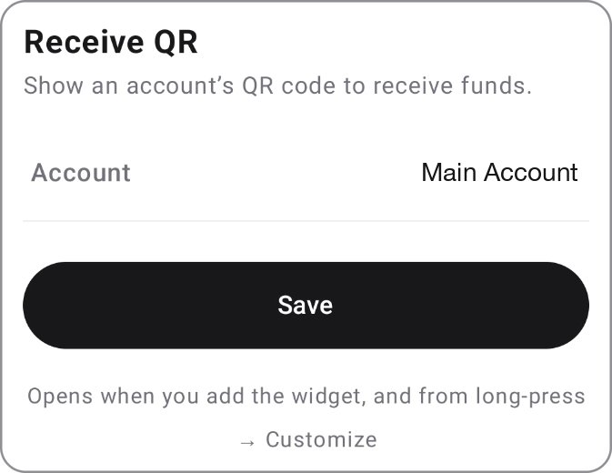

# Android widgets

What each Pera widget on Android shows, which options it has and what a tap does, then how the
widgets are built. The snapshot the widgets read, their fetches, deep links and privacy rules are
shared with iOS and live in [WIDGETS.md](WIDGETS.md).

| Widget                          | Size           | Options                                                |
| ------------------------------- | -------------- | ------------------------------------------------------ |
| Portfolio                       | 2×2, resizable | Chart period, Show chart, Account                      |
| Portfolio & Transactions        | 2×2, resizable | Chart period, Show chart, Account                      |
| Transactions                    | 2×2, resizable | Account                                                |
| Price                           | 2×2, resizable | Asset, Currency, Chart period, Show asset per currency |
| Receive QR                      | 2×2, resizable | Account                                                |
| Scan with Pera (Quick Settings) | Tile           | None                                                   |

## Behaviour shared by every widget

- **Adding and editing.** Widgets are added from the launcher's widget picker. A widget's settings
  screen opens when it is added and again from its long-press menu (Customize, or a pencil,
  depending on the launcher).
- **Size.** Every widget starts at 2×2 and can be resized both ways, down to 110 dp. The content
  fits itself to the space: rows are added or dropped, and secondary lines go first.
- **Look.** The app's theme (light, dark or system) and the app's language; the widget picker and
  the settings screens follow the phone's language. The text is the phone's system font. A Pera
  logo badge sits in the top-right corner, and off MainNet a yellow bar along the top names the
  network.
- **Privacy mode.** Balances show as `••••` with no chart, and Portfolio & Transactions keeps only
  its portfolio page. Transactions and Receive QR show the Pera logo. Prices still show: they reveal
  no holdings.
- **Locked phone.** Widgets live on the home screen only, which a locked phone doesn't show; none
  can be added to the lock screen.
- **Nothing to show.** Before the app has run once, or when the wallet has no signing accounts
  (watch accounts only), every widget shows the Pera logo, which has no tap.
- **Freshness.** Portfolio, Portfolio & Transactions, Transactions and Price fetch on their own,
  as [WIDGETS.md](WIDGETS.md) describes, and keep the last values they fetched when a fetch fails;
  Portfolio and Price show "Updated" and the time of the fetch. Receive QR changes when the app
  does.
- **Accounts.** Account options list the wallet's signing Algorand accounts; Receive QR lists every
  account that can receive, watch accounts included.

## Portfolio

The total value of the portfolio, or of one account.

**Shows**

- Title: "Portfolio Value", or the account's name when one account is picked.
- The ALGO amount, with "≈" and the value in the app's currency under it (not shown when the app's
  currency is ALGO). On a wide widget, the "≈" line sits beside the amount.
- A line chart of the chosen period, green when the period ended up, red when down.
- "Updated" and the time.

When the widget is short, the amount shrinks first, then the chart goes, then the "≈" line. The
title, the amount and "Updated" always stay.

**Options**

 

| Option       | Values                                                           | Default   |
| ------------ | ---------------------------------------------------------------- | --------- |
| Chart period | Default (the app's chart period), 1 day, 1 week, 1 month, 1 year | Default   |
| Show chart   | On, off                                                          | On        |
| Account      | Portfolio (every signing account), or one account                | Portfolio |

An account that has been removed from the app falls back to Portfolio.

**Tap:** set to Portfolio, opens the app home with the account drawer open. Set to one account,
opens that account.

## Portfolio & Transactions

The Portfolio widget with a second page of recent transactions, switched with a tab bar. It is the
Android counterpart of the iOS tabs variant; Android has no flip-button version.

 

**Shows:** the current page above a bar of two tabs, a chart icon (portfolio) and a list icon
(transactions). The selected tab is filled. At 2×2 the transactions page lists 2 rows, and more as
the widget grows taller.

- **Wide (250 dp or more):** both pages side by side, portfolio on the left and the latest
  transactions on the right. No tabs.
- **Too short for one transaction row:** the portfolio page alone. No tabs.

**Options:** the same as Portfolio. The Account option also picks whose transactions are listed.

**Tap:** the portfolio page or half taps as Portfolio. The transactions page or half, set to
Portfolio, opens the app home with the account drawer open; set to one account, it opens that
account's History tab.

**Buttons:** each tab shows its page. The page is kept per widget, so two copies on the home screen
can show different pages.

## Transactions

The most recent transactions of every account, or of one.

**Shows**

- Title: "Last transactions", or the account's name.
- One row per transaction, newest first, as many as the height fits, up to 6: 3 at 2×2.
- Each row has an icon for its type, with the amount (or the type when nothing moved) over when it
  happened: the time today, "Yesterday", then the date.
- Types: Send (amount with "−"), Receive (amount with "+", in green), Swap ("USDC → ALGO"), Opt-in,
  Opt-out, App Call, and Transaction for anything else.
- "No transactions available" when the account has none; a blank list before the first fetch or
  when it failed.

**Options**

| Option  | Values                                            | Default   |
| ------- | ------------------------------------------------- | --------- |
| Account | Portfolio (every signing account), or one account | Portfolio |

Set to Portfolio, the list covers the first five accounts. A removed account falls back to
Portfolio.

**Tap:** set to Portfolio, opens the app home with the account drawer open. Set to one account,
opens that account's History tab.

## Price

A verified asset's price and how it moved.

**Shows**

- Title: "ALGO price", or the asset's unit name, with a verified badge.
- For any asset but ALGO, its ID, so a look-alike asset can't pass for it. When the widget is
  short, the ID moves onto the title row; it is never dropped.
- The price, and the 24h change with ▲ (green) or ▼ (red).
- At 2×2: the "1 USD = 10.47 ALGO" line when Show asset per currency is on, otherwise a chart. A
  wide widget also draws the chart beside the figures.
- "Updated" and the time.

**Options**

| Option                  | Values                                                                | Default |
| ----------------------- | --------------------------------------------------------------------- | ------- |
| Asset                   | ALGO, and the verified, non-collectible assets the accounts hold      | ALGO    |
| Currency                | Default (the app's currency), ALGO, and the currencies the app offers | Default |
| Chart period            | Default, 1 day, 1 week, 1 month, 1 year                               | 1 week  |
| Show asset per currency | On, off                                                               | On      |

ALGO priced in ALGO says nothing, so that pair uses the app's currency. An asset the accounts no
longer hold falls back to ALGO, and one that loses its verification shows no price. Privacy mode
shares no asset list, so a widget set to another asset quotes ALGO until it is turned off.

**Tap:** opens the app.

## Receive QR

An account's QR code, to be scanned by whoever is paying.

**Shows:** the QR code of the account's receive address in a white frame (white in dark mode too,
so scanners read it), and the account's name under it. In privacy mode, or with no account to
show, the Pera logo.

**Options**

| Option  | Values                       | Default           |
| ------- | ---------------------------- | ----------------- |
| Account | Any account that can receive | The first account |

A removed account falls back to the first one.

**Tap:** opens that account in the app, on the account's network.

## Scan with Pera

A Quick Settings tile, not a widget: added from the Quick Settings editor.

**Shows:** the Pera petals inside QR brackets, labelled "Scan with Pera".

**Tap:** opens Pera's QR scanner. From the lock screen, the phone unlocks first; if the app lock is
on, the PIN comes before the scanner. The same action is on the app icon's long-press menu, as
"Scan QR Code".

## How it's built

### Module

The widgets are Jetpack Glance, inside the `PeraWidgets` Expo module
(`apps/mobile/native-modules/widgets/android/`), which also holds the bridge. Each widget has a
receiver in the module's `AndroidManifest.xml` and a `res/xml/*_widget_info.xml`: 2×2 target,
110 dp minimum, resizable both ways, `home_screen` only, reconfigurable through
`WidgetConfigActivity`. The picker preview is a `previewLayout`, plus a `previewImage` PNG for
launchers that don't render the layout, such as ColorOS.

What each widget stores, all in app-private SharedPreferences:

| File                  | Holds                                                                   |
| --------------------- | ----------------------------------------------------------------------- |
| `pera_widgets`        | The snapshot, as the app last wrote it                                  |
| `pera_widgets_config` | Each widget's options, keyed by widget id, including the picked account |
| `pera_widgets_quotes` | The last fetched values per widget                                      |

The app clears all three whenever it clears the snapshot: on a wallet wipe, and when the wallet
has no signing accounts left, which also resets every widget's options.

### Sizes

Widgets use `SizeMode.Responsive` with tight steps around a 2×2 (`ui/PeraSizeMode.kt`). With
`Exact`, the launcher picks between a landscape and a portrait render, and ColorOS draws the
landscape one on a portrait home screen, where a 2×2 is about 146 × 137 dp. Each layout
(`PortfolioLayout.kt`, `PriceLayout.kt`, `TransactionsLayout.kt`) fits its rows to the real height,
dropping content in a fixed order rather than clipping it.

### Refresh

- WorkManager is the only scheduler: `updatePeriodMillis` is 0, so two schedulers don't double the
  passes. A periodic job runs every 30 minutes, a one-off job 5 minutes after a failed fetch, and
  `onUpdate` hands its fetch to the job, because a receiver can't do network work.
- The periodic job has no network constraint: offline, the fetch fails fast and keeps the last
  value, but the redraw still runs, so an "Updated" time from yesterday gains its day.
- Android can't redraw every minute (Doze can hold a redraw for hours), so transaction rows show a
  time, "Yesterday" or a date rather than an age, which never goes stale.
- A value fetched less than 5 minutes ago is reused rather than fetched again, so a snapshot write
  redraws without always fetching.
- Portfolio & Transactions fetches both pages on every pass; its tab bar is a Glance
  `ActionCallback`, so a tab tap only redraws, unless the page has never been fetched. The page is
  Glance state of that one widget.

### Look and language

- Colours are hand-copied from the app's tokens in `ui/PeraTheme.kt`, which applies the snapshot's
  `theme`.
- Glance can't render a bundled font, so the text is the system font rather than DM Sans.
- Labels come from `snapshot.strings`, with English fallbacks. The widget picker and the settings
  screens use the module's `res/values*/strings.xml`; `values-pt` is a copy of `values-pt-rBR`, as
  on iOS.
- **Trap:** the layout direction follows the phone, not the snapshot's locale.

### Settings screen

`WidgetConfigActivity` is a native activity, not React Native, so it opens without the app lock, as
the widget itself does. Its account and asset lists come from the snapshot, so in privacy mode
they hold only their default and the Receive QR list is empty; the currency list is fetched live.

### Scan tile

`ScanTileService` opens `perawallet://app/scan`, the link the app's quick action uses, so a locked
app shows the PIN first and the scanner after it. From the lock screen it calls `unlockAndRun`
rather than opening a wallet over the keyguard. Its icon is the same glyph as the iOS control, as a
vector drawable.

### Testing

The pure logic (fetchers, layouts, formatting, pinning, options) has JVM tests in the module. Run
`./gradlew :widgets:testDebugUnitTest` from the Android project that prebuild generates under
`apps/mobile`.
