# iOS widgets

What each Pera widget on iOS shows, which options it has and what a tap does, then how the
extension is built. The snapshot the widgets read, their fetches, deep links and privacy rules are
shared with Android and live in [WIDGETS.md](WIDGETS.md).

| Widget                          | Sizes                                      | Options                                                |
| ------------------------------- | ------------------------------------------ | ------------------------------------------------------ |
| Portfolio                       | Small, Medium                              | Chart period, Show chart, Account                      |
| Portfolio & Transactions        | Small, Medium                              | Chart period, Show chart, Account                      |
| Portfolio & Transactions (tabs) | Small                                      | Chart period, Show chart, Account                      |
| Transactions                    | Small, Medium                              | Account                                                |
| Price                           | Small, Medium                              | Asset, Currency, Chart period, Show asset per currency |
| NFTs                            | Small                                      | NFT, Change every                                      |
| Receive QR                      | Small                                      | Account                                                |
| Cloud Backup                    | Small                                      | None                                                   |
| Passphrase Backup               | Small                                      | None                                                   |
| Backups                         | Medium                                     | None                                                   |
| Inbox                           | Small                                      | None                                                   |
| Inbox List                      | Medium                                     | None                                                   |
| Signatures                      | Small                                      | None                                                   |
| Notifications                   | Medium                                     | None                                                   |
| Inbox & Notifications           | Small, Medium                              | None                                                   |
| Scan with Pera (control)        | Control Center, Lock Screen, Action button | None                                                   |

Widgets need iOS 17 and the control iOS 18; the app itself runs on iOS 16.4.

## Behaviour shared by every widget

- **Adding and editing.** Widgets are added from the home screen's widget gallery. A widget with
  options opens them on long-press → Edit Widget.
- **Look.** The app's theme (light, dark or system) and the app's language, not the phone's; the
  gallery text and Edit Widget labels follow the phone's language. A Pera logo badge sits in the
  top-right corner, and off MainNet a yellow bar along the top names the network.
- **Privacy mode.** Balances show as `••••`, and Portfolio & Transactions keeps only its portfolio
  page. Transactions, NFTs, Receive QR and the inbox widgets show the Pera logo. Prices and backup
  status still show: they reveal no holdings.
- **Locked phone.** Balances, charts, transaction rows, NFT images, inbox counts and rows,
  notification text and the Receive QR are hidden until the phone is unlocked (StandBy and the Mac
  desktop included); backup status isn't. No widget is offered on the lock screen; only the Scan
  control can go there.
- **Nothing to show.** Before the app has run once, or when the wallet has no signing accounts
  (watch accounts only), every widget shows the Pera logo.
- **Freshness.** Portfolio, Transactions, Price and the inbox widgets fetch on their own, as
  [WIDGETS.md](WIDGETS.md) describes; after a failed fetch they show what the app last wrote, or
  `—`. The other widgets change when the app does, and NFTs at their chosen interval.
- **Accounts.** Account options list the wallet's signing Algorand accounts; Receive QR lists every
  account that can receive, watch accounts included.

## Portfolio

The total value of the portfolio, or of one account.

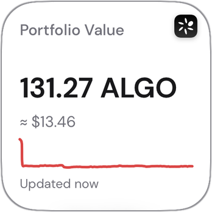 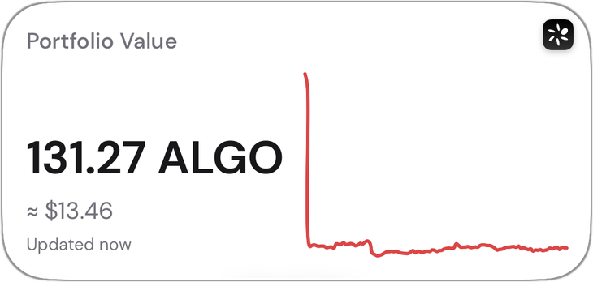

**Shows**

- Title: "Portfolio Value", or the account's name when one account is picked.
- The ALGO amount, with "≈" and the value in the app's currency under it (not shown when the app's
  currency is ALGO).
- A line chart of the chosen period, green when the period ended up, red when down. Small: under the
  amounts. Medium: beside them.
- "Updated" and the time of the chart's latest point.

**Options**

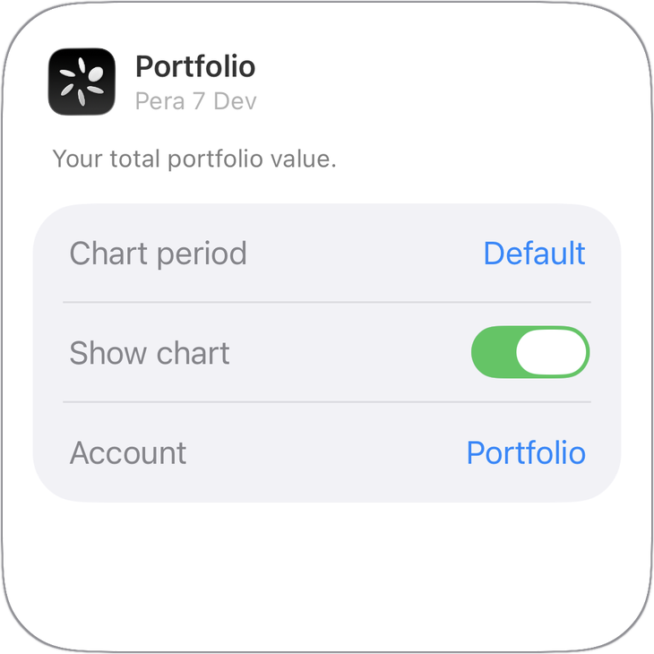

| Option       | Values                                                           | Default   |
| ------------ | ---------------------------------------------------------------- | --------- |
| Chart period | Default (the app's chart period), 1 day, 1 week, 1 month, 1 year | Default   |
| Show chart   | On, off                                                          | On        |
| Account      | Portfolio (every signing account), or one account                | Portfolio |

An account that has been removed from the app falls back to Portfolio.

**Tap:** set to Portfolio, opens the app home with the account drawer open. Set to one account,
opens that account.

## Portfolio & Transactions

The Portfolio widget with a second page of recent transactions.

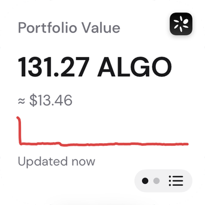 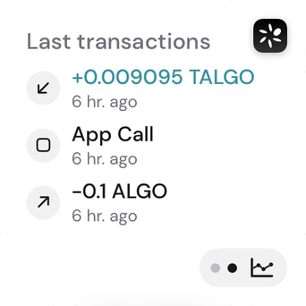 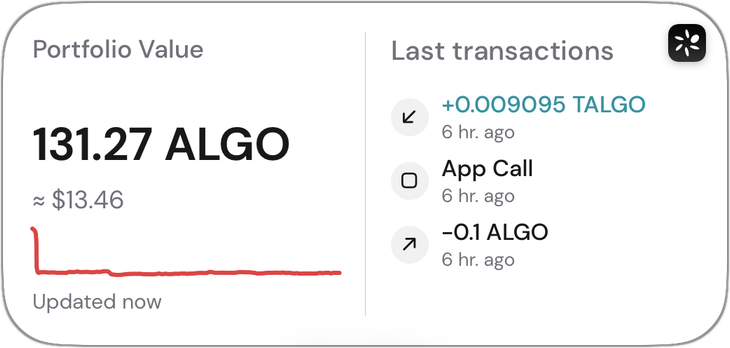

**Small:** one page at a time. A capsule button in the bottom-right corner switches between the
portfolio page and the transactions page (3 rows): two dots show which page is on, and an icon the
page it switches to.

**Medium:** both side by side: portfolio on the left, the latest 3 transactions on the right. No
button.

**Options:** the same as Portfolio. The Account option also picks whose transactions are listed.

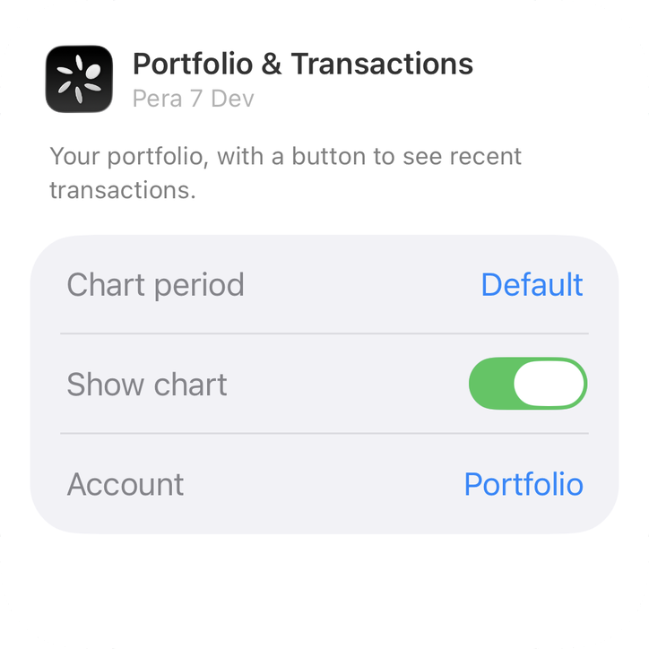

**Tap:** the portfolio page or half taps as Portfolio. The transactions page or half, set to
Portfolio, opens the app home with the account drawer open; set to one account, it opens that
account's History tab.

**Buttons:** the page button switches page. The page is shared by every copy of this widget on the
home screen.

## Portfolio & Transactions (tabs)

The same two pages as Portfolio & Transactions, switched with a tab bar instead of a button. Small
only.

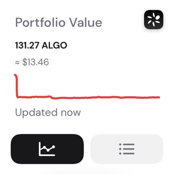 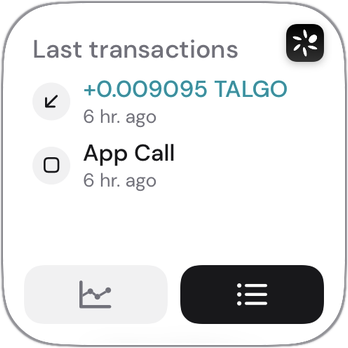

**Shows:** the current page above a bar of two tabs, a chart icon (portfolio) and a list icon
(transactions). The selected tab is filled. The transactions page lists 2 rows.

**Options:** the same as Portfolio.

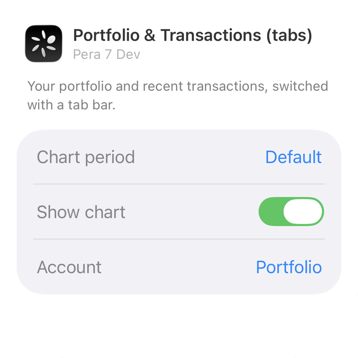

**Tap:** as Portfolio & Transactions.

**Buttons:** each tab shows its page; tapping the selected tab does nothing. The page is shared by
every copy of this widget on the home screen.

## Transactions

The most recent transactions of every account, or of one.

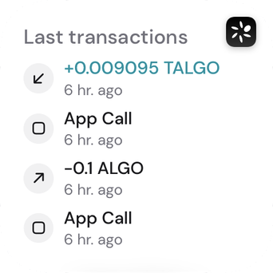 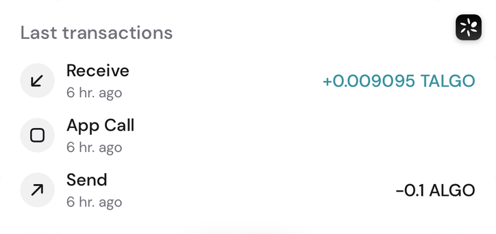

**Shows**

- Title: "Last transactions", or the account's name.
- One row per transaction, newest first: Small shows 4, Medium shows 3.
- Each row has an icon for its type, and:
    - **Small:** the amount (or the type when nothing moved) over how long ago it happened.
    - **Medium:** the type over how long ago, with the amount on the right.
- Types: Send (amount with "−"), Receive (amount with "+", in green), Swap ("USDC → ALGO"), Opt-in,
  Opt-out, App Call, and Transaction for anything else.
- "No transactions available" when the account has none; "—" when they couldn't be loaded.

**Options**

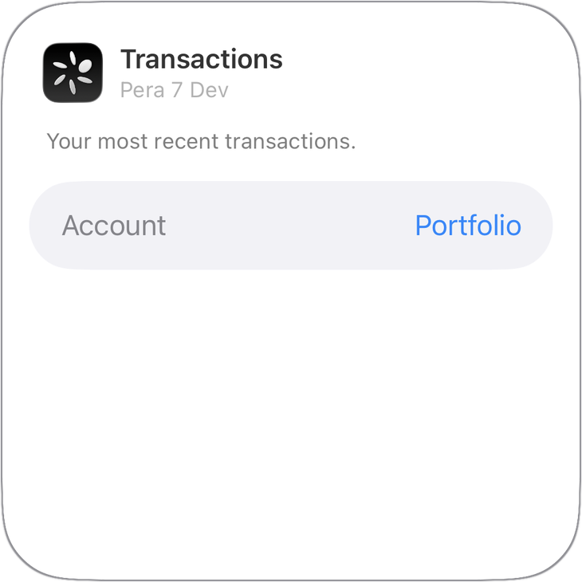

| Option  | Values                                            | Default   |
| ------- | ------------------------------------------------- | --------- |
| Account | Portfolio (every signing account), or one account | Portfolio |

Set to Portfolio, the list covers the first five accounts. A removed account falls back to
Portfolio.

**Tap:** set to Portfolio, opens the app home with the account drawer open. Set to one account,
opens that account's History tab.

## Price

A verified asset's price and how it moved.

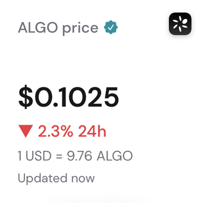

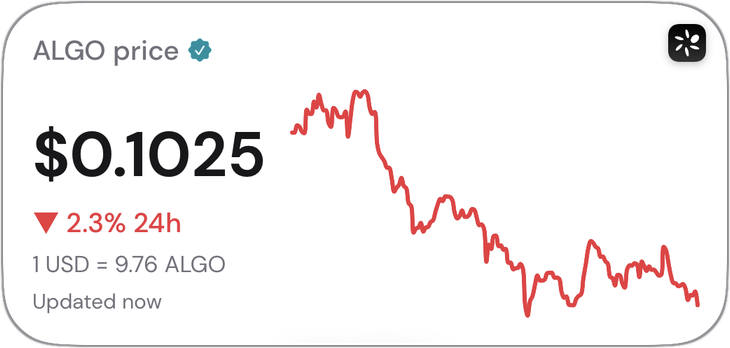

**Shows**

- Title: "ALGO price", or the asset's unit name, with a verified badge.
- For any asset but ALGO, its ID under the title, so a look-alike asset can't pass for it.
- The price, and the 24h change with ▲ (green) or ▼ (red). The chart takes the 24h change's colour,
  whatever its period.
- Small: the "1 USD = 10.71 ALGO" line when Show asset per currency is on, otherwise a chart.
  Medium: both, with the chart beside the figures.
- "Updated" and the time of the fetch.

**Options**

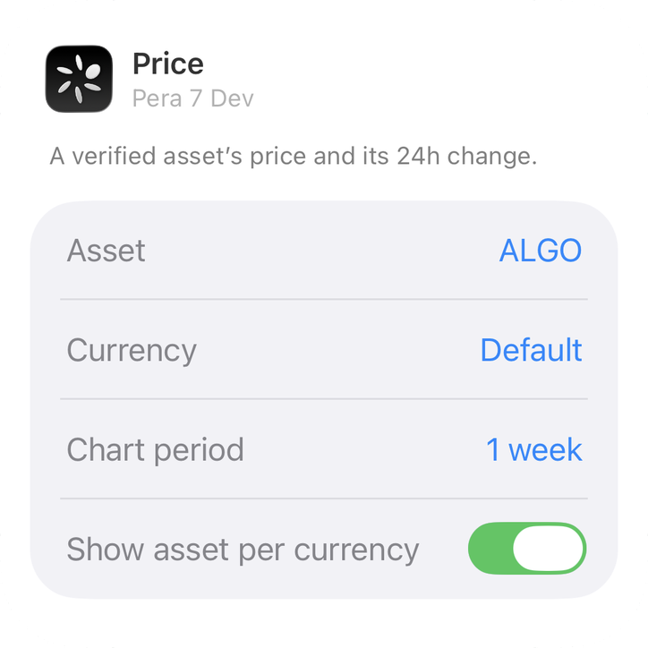

| Option                  | Values                                                                | Default |
| ----------------------- | --------------------------------------------------------------------- | ------- |
| Asset                   | ALGO, and the verified, non-collectible assets the accounts hold      | ALGO    |
| Currency                | Default (the app's currency), ALGO, and the currencies the app offers | Default |
| Chart period            | Default, 1 day, 1 week, 1 month, 1 year                               | 1 week  |
| Show asset per currency | On, off                                                               | On      |

ALGO priced in ALGO says nothing, so that pair uses the app's currency. An asset that loses its
verification shows no price.

**Tap:** opens the app.

## NFTs

One of the accounts' NFTs, full bleed.

**Shows:** the NFT's image filling the widget, with its name and collection along the bottom. It
picks from the first 10 NFTs with an image. With none, the Pera logo and "No NFTs yet".

**Options**

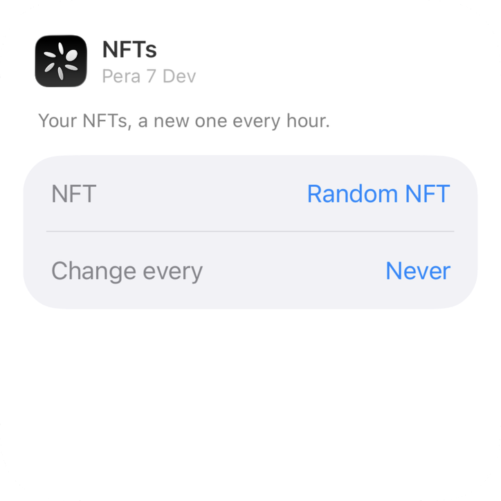

| Option       | Values                        | Default    |
| ------------ | ----------------------------- | ---------- |
| NFT          | Random NFT, or one NFT        | Random NFT |
| Change every | Never, 1 hour, 6 hours, 1 day | Never      |

A picked NFT that is no longer held falls back to Random NFT. With Change every set, the widget
moves to another NFT at each interval, a picked one included.

**Tap:** opens that NFT in the app. With no NFT showing, opens the app.

## Receive QR

An account's QR code, to be scanned by whoever is paying.

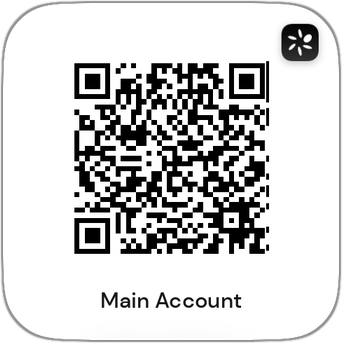

**Shows:** the QR code of the account's receive address on a white square, and the account's name
under it. In privacy mode, or with no account to show, the Pera logo.

**Options**

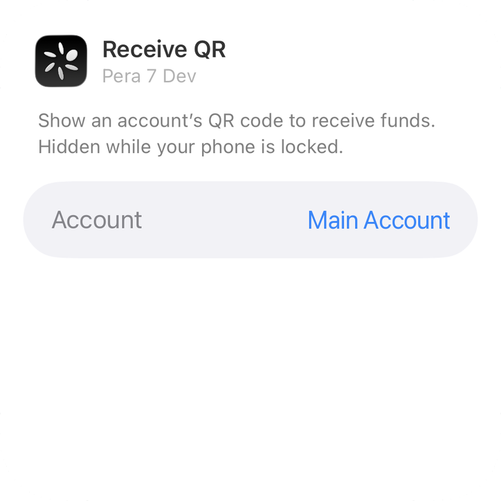

| Option  | Values                       | Default           |
| ------- | ---------------------------- | ----------------- |
| Account | Any account that can receive | The first account |

A removed account falls back to the first one. iOS is asked not to suggest the widget for StandBy.

**Tap:** opens that account in the app. With no account showing, opens the app.

## Cloud Backup

Whether the wallet is backed up to the cloud.

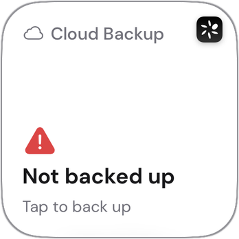

**Shows:** a cloud icon, the status and a second line:

| Status                   | Second line                                        |
| ------------------------ | -------------------------------------------------- |
| Not backed up            | Tap to back up                                     |
| 2 accounts not in backup | Tap to back up                                     |
| Backup failed            | Last successful sync: the date, when there was one |
| Backed up                | Last sync: the date                                |
| Not available            | None (a minus icon)                                |

**Tap:** opens the app's cloud backup flow. When cloud backup isn't available, opens the app.

## Passphrase Backup

Which accounts still need their recovery passphrase backed up.

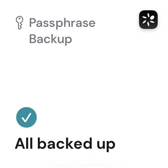

**Shows:** a key icon and either "All backed up", or how many accounts still need a backup
("1 account needs a backup") with "Tap to back up".

**Tap:** opens the passphrase backup of the first account that needs one; when none does, the app
home.

## Backups

Cloud Backup and Passphrase Backup side by side. Medium only.

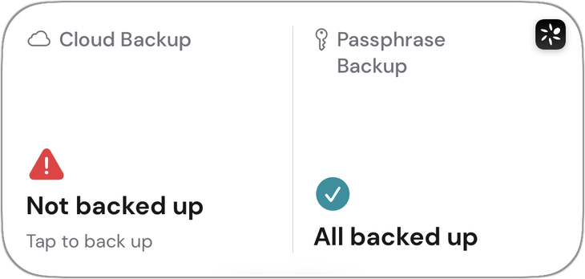

**Tap:** each half opens its own flow, as the single widgets do.

## Inbox

How many requests are waiting.

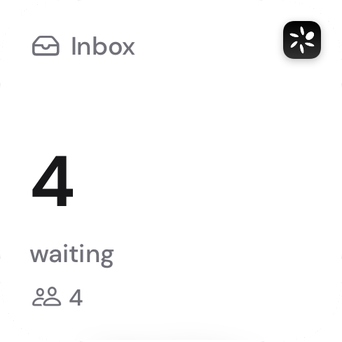

**Shows:** the number waiting ("3 waiting") and, under it, a count per kind: signature requests,
incoming assets and shared-account invitations. With nothing waiting, a green check and "All caught
up".

**Tap:** opens the inbox.

## Inbox List

The latest inbox items. Medium only.

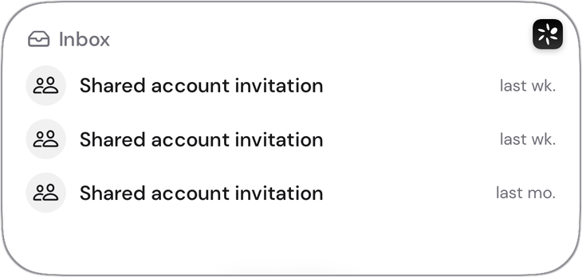

**Shows:** up to 3 rows: dated items newest first, then incoming assets. Each has an icon and label
for its kind (signature request, incoming assets, invitation), with the account's name under it when
the account is one of the user's; on the right, how long ago it arrived, or for incoming assets how
many are waiting. "All caught up" when empty.

**Tap:** each row opens its own item: a signature request opens that request, incoming assets open
that account's asset inbox, an invitation opens the inbox.

## Signatures

Shared-account transactions waiting for the user's signature. Small only.

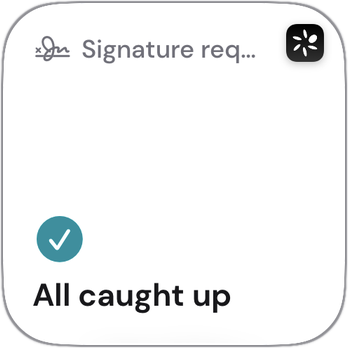

**Shows:** the number to sign ("2 to sign"), or "All caught up".

**Tap:** with exactly one request, opens it. Otherwise, opens the inbox.

## Notifications

The latest Pera notifications. Medium only.

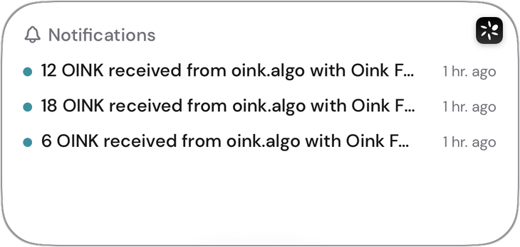

**Shows:** up to 3 notifications with how long ago each arrived. "No notifications yet" when empty.

**Tap:** opens the notifications screen.

## Inbox & Notifications

The inbox count and the latest notifications in one widget.

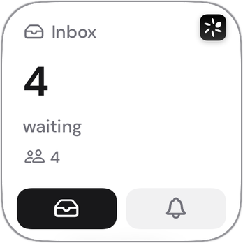 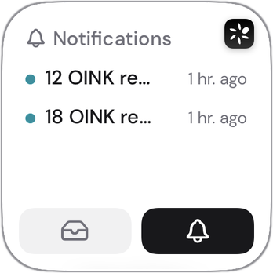 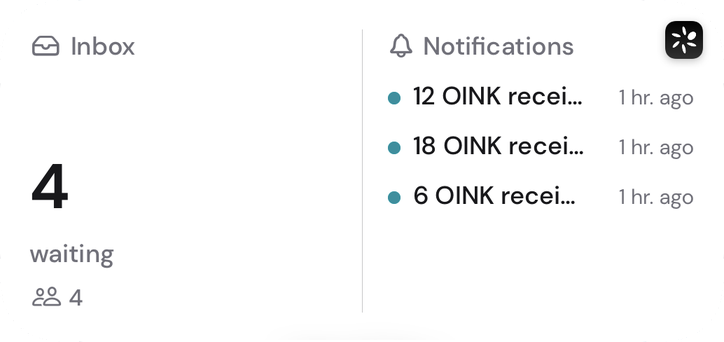

**Small:** one page at a time, switched with a tab bar of two tabs, a tray (inbox) and a bell
(notifications). The notifications page lists 2.

**Medium:** both side by side: the inbox count on the left, notifications on the right. No tabs.

**Tap:** the inbox page or half opens the inbox; the notifications page or half opens notifications.

**Buttons:** each tab shows its page. The page is shared by every copy of this widget on the home
screen.

## Scan with Pera

A control, not a widget: added to Control Center or the Lock Screen, or assigned to the Action
button.

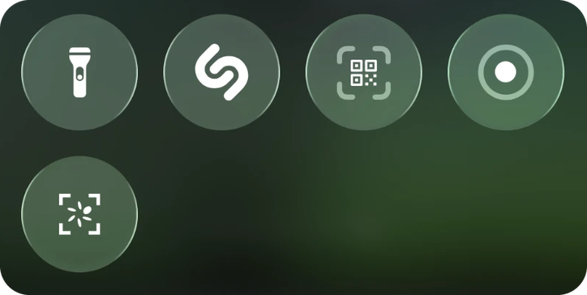

**Shows:** the Pera petals inside QR brackets, labelled "Scan with Pera".

**Tap:** opens Pera's QR scanner. From a locked phone, iOS asks to unlock first; if the app lock is
on, the PIN comes before the scanner. The same action is on the app icon's long-press menu, as
"Scan QR Code".

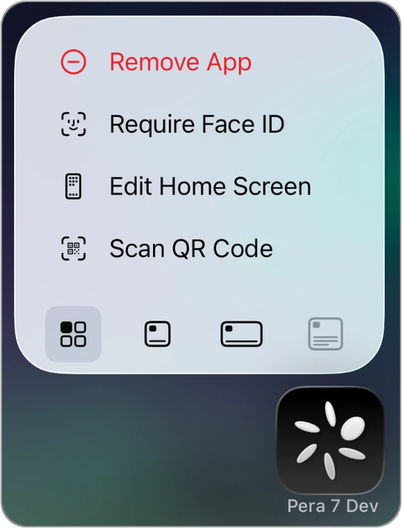

## How it's built

### Target

`ios/` is regenerated by prebuild, so the extension target is recreated from code on every prebuild
by `@bacons/apple-targets`, which references `apps/mobile/targets/widget/` in place: the Swift
edited in Xcode is the committed source, and adding a widget means adding a Swift file. A
hand-written config plugin was rejected: the passkey-autofill extension is added that way, and
`apps/mobile/plugins/withPasskeyAutofillFixes.js` exists to repair what hand-rolled pbxproj surgery
gets wrong (missing target dependency, duplicate sources, an embed phase ordered after the Firebase
scripts causing an Xcode "Cycle inside" error). Verify both extensions still embed after a change to
either plugin.

- **Deployment target 17.0**, for `containerBackground(for: .widget)`, which iOS 17 requires for
  correct rendering in StandBy and on the Mac desktop.
- **Bundle ID** `<app bundle id>.widget`, which needs its own App ID with the App Group capability
  and provisioning profiles for every variant before CI can sign it.
- **App Group** `group.<app bundle id>`, the one the passkey-autofill plugin already provisions
  (the app's Info.plist carries it as `AppGroupIdentifier`). `apple-targets` only mirrors groups
  listed in `ios.entitlements`, and Pera's is added by a mod, so the target config sets it
  explicitly. The snapshot is a string under `pera.widgets.snapshot` in the group's defaults, and
  NFT images are `widgets/nft-<key>.jpg` in its container.

### Look and language

- **Colours** are colour sets declared through the `apple-targets` `colors` option in
  `expo-target.config.js`, a hand-copied subset of the app's tokens under the same names.
- **Typography** is DM Sans, the app's font, with only the weights the widgets use bundled and
  registered in the extension's Info.plist `UIAppFonts`.
- iOS overrides colours in tinted and vibrant rendering (StandBy at night, the inactive Mac
  desktop), so meaning never depends on colour alone: a price change carries ▲/▼ as well.
- Swift sets `.environment(\.locale, …)` from `snapshot.locale`, which localises relative dates and
  sets the layout direction. Gallery text and Edit Widget labels come from the extension's string
  catalog, `Localizable.xcstrings`.
- **Trap:** before the first snapshot, or if it fails to decode, the widget knows no language, so
  its placeholder is the logo with no text.
- **Trap:** the catalog carries `pt` as a copy of `pt-BR`. iOS never falls back from `pt-PT` to
  `pt-BR`, so without it a Portuguese phone skips to the next language in its list.

### Locked phone

The redaction is `.privacySensitive()` on the views listed under "Locked phone" above. No widget
declares an accessory (lock-screen) family. Receive QR, the one widget that renders an address, is
also disfavoured for StandBy; iOS can't forbid a home-screen widget there, so redaction covers the
rest. iPhone widgets reach the Mac desktop on macOS 14+ through Continuity: they run on the phone,
and a tap prompts to continue on the iPhone.

### Timelines and options

- A self-refreshing widget's timeline holds one entry per minute until its next reload, so row
  ages ("6 hr. ago") advance. iOS keeps no fetched values between reloads, and may defer one.
- Each widget's options are a `WidgetConfigurationIntent` in `WidgetIntents.swift`, named by the
  widget's `AppIntentConfiguration`, so two copies of a widget can be configured differently. The
  account and NFT lists come from the snapshot, so in privacy mode they hold only their default,
  and the Receive QR list is empty.

### Multi-page widgets

An app can't put its widgets in a Smart Stack, so two-page widgets switch with iOS 17 interactive
buttons running an `AppIntent`. The page lives in the App Group per widget kind (`WidgetPageStore`
in `WidgetPages.swift`), shared by every copy of that kind, and only the current page's data is
fetched. The tab bar (`SegmentedPageBar`) gives each icon a VoiceOver label, so it needs no room for
translations.

### Scan control

A control's `OpenURLIntent` with a custom scheme can silently do nothing, so the control doesn't
open `perawallet://app/scan` itself. Its intent (`OpenScannerIntent`, in `targets/_shared` so the
app compiles it too) is marked to open the app, records a timestamped request in the App Group and
posts a Darwin notification; the app checks the request on activation and on that notification,
because iOS may activate the app before the intent runs. A request older than a minute is dropped,
so a missed one can't open the scanner later. A request is ignored while any QR scanner is open,
and running the control briefly backgrounds Pera, so an open scanner rides out the app lock's
resume check covered, with its camera paused, rather than being dismissed and re-presented. The
icon is an SF Symbols template of the Pera petals in `apps/mobile/targets/symbols/pera-scan.svg`.

### NFT images

`AsyncImage` does nothing in WidgetKit, and the extension is killed silently above roughly 30 MB.
The native module downloads each image (https only, 10 MB cap, 15 s timeout) and downsamples it with
ImageIO `CGImageSourceCreateThumbnailAtIndex` to 600 px, which also yields a static frame for a GIF.
The NFT order and the current slot derive from a start time in the App Group (`NftSchedule`), so a
timeline rebuild keeps the NFT already showing until its interval ends.

### Testing

- The extension's Foundation-only logic (fetchers, transaction classifier, deep links, snapshot
  decoding, pinning) has XCTest coverage in the Swift package at `apps/mobile/targets/widget-core`,
  whose sources are symlinks to the shipped files. Run `pnpm --filter mobile test:widget-core`; it
  needs no simulator or Xcode project.
- `#Preview`s use the fixtures in `Fixtures.swift`: MainNet, TestNet in privacy mode (dark,
  `pt-BR`), an empty snapshot in Arabic (right to left), a snapshot with live feeds, and no snapshot.
